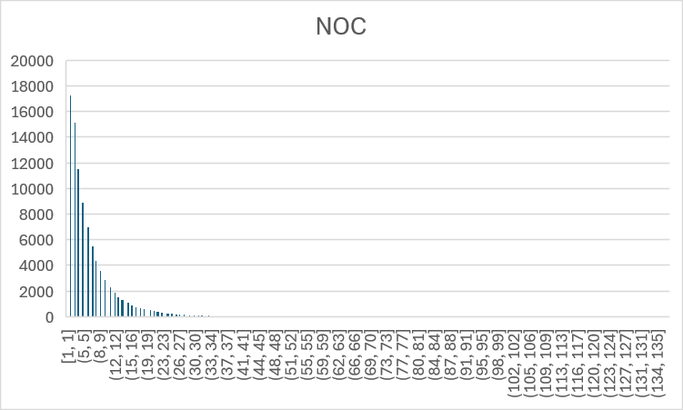
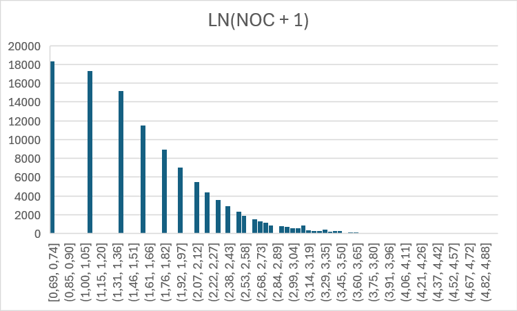
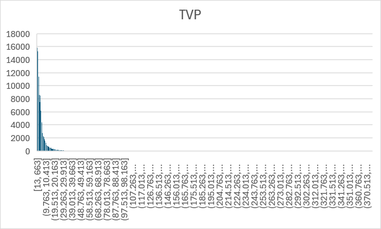
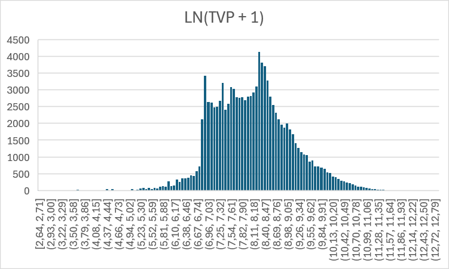
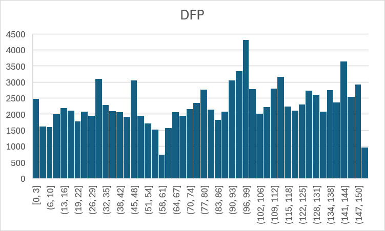
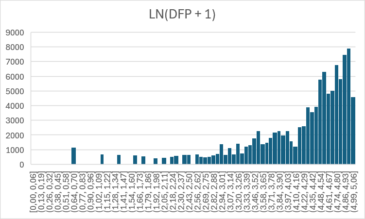
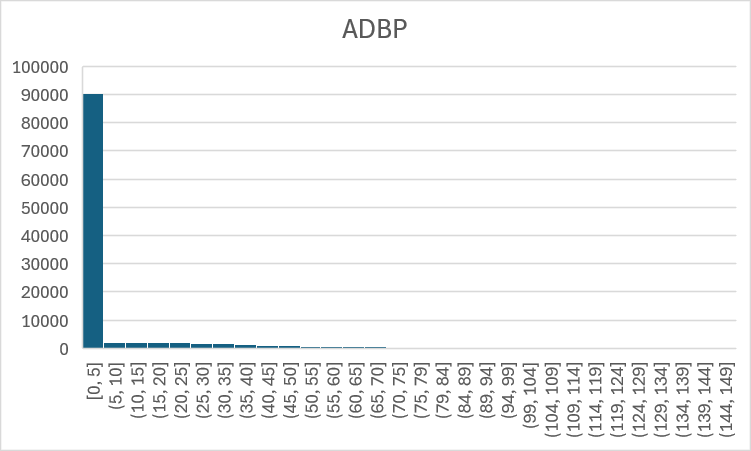
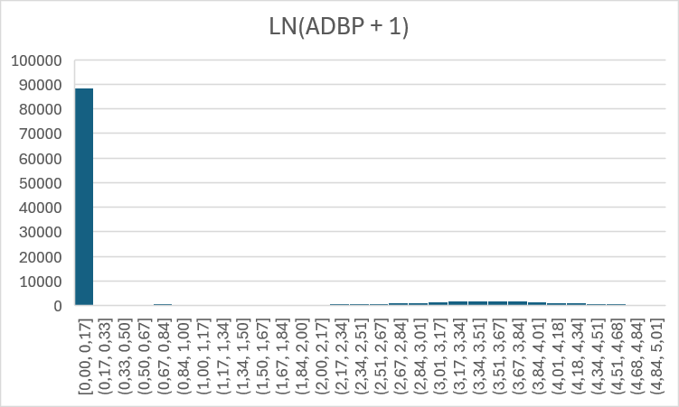

### Introduction

The goal is to segment customers with k-means, using the elbow method to choose the number of clusters.

We start from the events table filtered to purchase events before 1 February 2023: **1,044,100** rows from **92645** distinct users.


|  Column       |           Type           |
|---------------|--------------------------|
| event_time    | timestamp with time zone |
| event_type    | event_type_t             |
| product_id    | integer                  |
| category_id   | bigint                   |
| user_id       | bigint                   |
| user_session  | uuid                     |
| price         | numeric(8,2)             |
| category_code | text                     |
| brand         | text                     |


### features

We have to create feature to cluster the customer on them.
Event_time, product_id, price, user_session, 

+ Category_id has 43 missing values. we can use it.
+ Event_type is full populated wiht `purchase'. It carries no information,
+ Brand has 438_912 null values 42%. Dropped for simplicity
+ Category_code has 1_030_261 null values 99%. It Is useless.Dropped

So, for each user_id we can figure out features on

We treat each session as one order (ticket) and use 1 February as the reference date.

+ event_time
    + (adbt) average days betweeen purchase days
    + (dlp) days from last purchase '2023-02-01' - MAX(event_time)::date
    + (dfp) days from first purchase '2023-02-01 - MIN(event_time)::date
+ product_id
    + (ndp) number of distint product ==> COUNT(DISTINCT product_id)
    + (noi) number of itmes ==> COUNT(product_id)
+ category_id
    + (noc) number od distinct categories ==> NULLIF(COUNT(DISTINCT category_id, 0)
+ user_sesion
    + (nos) number of sesions ==> COUNT(DISTINCT user_session)
+ price
    + (tvp) total value purchased ==> SUM(price)
    + (atv) average ticket value (tvp / nos)
    + (aiv) Average item value (tvp / noi)


All features are log-transformed and standardized before clustering, since they are skewed and k-means is sensitive to scale.

### Row filtering

How many negative (returns) or zero price (suspicious) sales has our dataset. 
```sql
SELECT COUNT(*) AS n_rows, COUNT(DISTINCT user_id) AS n_users, MIN(price), MAX(price)
FROM customers
WHERE price < 0;
```
Only 81 users in 92645 returned something. I will drop this records
```txt
 n_rows | n_users |  min   |  max
--------+---------+--------+-------
     87 |      81 | -79.37 | -7.94
```

### log_trasn

K_means uses euclidean distance to the cluster's centroid. Two considerations

The distinct features's scale matters. If one feature ranges from 0 to 300 and other feature ranges from 1 to 50, calculing the distante the former wheights more than the latter. Min-max normalization solves it.

Let's explore noc feature for the 110518 users.

```sql
 SELECT noc, count(*) AS users FROM user_features_raw GROUP BY 1 ORDER BY 1;
 ```

```txt
 noc | users
-----+-------
   1 | 18397
   2 | 17323
   3 | 15184
   4 | 11569
   5 |  8955
   6 |  7031
   7 |  5544
   8 |  4396
   9 |  3572
  10 |  2905
  11 |  2362
  12 |  1917
  13 |  1576
  14 |  1301
  15 |  1152
  16 |   904
  17 |   787
  18 |   718
  19 |   593
  20 |   554
  21 |   449
  22 |   418
  23 |   345
  24 |   279
  25 |   256
  26 |   218
  27 |   211
  28 |   184
  29 |   157
  30 |   123
  31 |   150
  32 |   127
  33 |   103
  34 |    70
  35 |    74
  36 |    64
  37 |    64
  38 |    43
  39 |    44
  40 |    37
  41 |    36
  42 |    44
  43 |    29
  44 |    37
  45 |    25
  46 |    25
  47 |    21
  48 |    18
  49 |    12
  50 |    10
  51 |     9
  52 |     5
  53 |     7
  54 |     8
  55 |     9
  56 |     8
  57 |     4
  58 |     2
  59 |     5
  60 |     5
  61 |     5
  62 |     6
  63 |     1
  64 |     2
  65 |     2
  66 |     3
  67 |     2
  68 |     2
  69 |     2
  70 |     1
  72 |     2
  76 |     2
  78 |     1
  79 |     2
  81 |     1
  82 |     1
  83 |     2
  85 |     1
  97 |     1
 118 |     1
 127 |     1
 128 |     1
 137 |     1

 ```

Noc's raw distribution

|Percentil     | noc|
|--------------|----|
|25 %	       |   2|
|50 % (mediana)|   4|
|75 %	       |   7|
|90 %	       |  13|
|99 %	       |  31|
|máximo	       | 137|

the skewness, 3,21, is higher than the practical threshold. 99% of the users has 31 categories or less. 988 usera has 32 or more categories.

let's compare both normalizations

|noc|min-max directo|ln(1+x)|	ln(1+x) + min-max|
|---|---------------|-------|--------------------|
|  1|0.000	        |  0.693|0.000               |
|  2|0.007	        |  1.099|0.096               |
|  3|0.015	        |  1.386|0.164               |
|  5|0.029	        |  1.792|0.259               |
| 10|0.066	        |  2.398|0.403               |
| 20|0.140	        |  3.045|0.555               |
| 31|0.221          |  3.466|0.655               |
| 37|0.265	        |  3.638|0.695               |
|137|1.000	        |  4.927|1.000               |

Ln(1 + x) Change the shape. Chagnes from range 1-137 to 0,693-4.927. Later min-max translates it to 0-1.

Without Logaritm 99% of the users fit between 0 and 0,221, and 988 user fit in 78% of the space form 0,2 to 1. A customer buying 10 categorie is only at 0,066 distant form a customer buying only one category. They are almos the same. Percentill falls 

With the logaritm a customer buyin 10 categories distances 0,403 form a customer buyin one category. Now 99% ot the users fit between 0 and 0,655, and 988 users fall into 35% of the rang 0-1 .skewnees reduce to 0,51.

|without LN()| with LN(noc + 1)|
|-----------------------|------------------------|
||
|||
|||
|||

#### withou


##


```txt

 user_id  |         noc         |         nos         |         ndp         |         noi         |          tvp           |         dlp         |          atv           |          aiv           |          adbp
-----------+---------------------+---------------------+---------------------+---------------------+------------------------+---------------------+------------------------+------------------------+------------------------
   9794320 | 0.09903052904958949 |                   0 | 0.17053739033287585 |  0.1673783188403832 | 0.31417531674800578000 |  0.8579704447880795 | 0.34466376695490405721 | 0.23381757326696093225 | 0.0
  10079204 | 0.09903052904958949 |                   0 |  0.0754639974000092 | 0.07406608599518133 | 0.39894424161564441024 |  0.9169048741496012 | 0.43765890504537285556 | 0.44948306741053144903 | 0.0
  10280338 |  0.3059739964375307 | 0.17542506358195453 | 0.39830294683420203 | 0.40136579262030314 | 0.52673810611246077140 |  0.5697355689903921 | 0.42970124812806949204 | 0.27641984443422922037 | 0.68870719821290782344
  12055855 | 0.16929380759878143 |                   0 | 0.17053739033287585 |  0.1673783188403832 | 0.34548920502626364586 |  0.7489560951925591 | 0.37901644240918249306 | 0.27109444839595729128 | 0.0
  12936739 | 0.09903052904958949 |                   0 |  0.0754639974000092 | 0.07406608599518133 | 0.41679121548014639108 |  0.5038463368711258 | 0.45723779909903507346 | 0.47399782554734439591 | 0.0
  15400971 | 0.16929380759878143 |                   0 |  0.1290065556458325 |  0.1266168103149703 | 0.43853863002664934113 |  0.7847281309520517 | 0.48109564349213748313 | 0.43609493798028656728 | 0.0
  15781728 | 0.09903052904958949 |                   0 |  0.0754639974000092 | 0.07406608599518133 | 0.37001787374530792649 |  0|.8845503685370916 | 0.40592544164757789901 | 0.41002204440821914757 | 0.0
  19762782 |                   0 |                   0 | 0.27993455044585086 | 0.27474898230533296 | 0.53869479075014873175 |   0.905633126904476 | 0.59097123778139262403 | 0.40810549389941207570 | 0.0
  20554973 | 0.09903052904958949 |                   0 | 0.25801311129166493 | 0.25323362062994054 | 0.37858781829899650758 |  0.5323850333776357 | 0.41532703755601178213 | 0.23147104338733762722 | 0.0
  23633626 |  0.3059739964375307 |                   0 | 0.27993455044585086 | 0.27474898230533296 | 0.38034299503621291388 | 0.22201620940534117 | 0.41725254154589345770 | 0.21558128011418371778 | 0.0

  ```


  

 WITH base AS (SELECT user_id, COUNT(DISTINCT category_id) AS noc, NULLIF(COUNT(DISTINCT user_session),0) AS nos, COUNT(DISTINCT product_id) AS ndp, COUNT(product_id) AS noi, SUM(price) AS tvp, '2023-02-01' - MAX(event_time):
:date as dlp FROM purchased_before_feb GROUP BY user_id) SELECT *, tvp / nos AS atv, tvp / noi AS aiv FROM base;


WITH base AS (
        SELECT 
            user_id, 
            COUNT(DISTINCT category_id) AS noc, 
            NULLIF(COUNT(DISTINCT user_session),0) AS nos, 
            COUNT(DISTINCT product_id) AS ndp, 
            COUNT(product_id) AS noi, 
            SUM(price) AS tvp, 
            '2023-02-01' - MAX(event_time)::date as dlp 
        FROM purchased_before_feb
        WHERE price > 0
        GROUP BY user_id
        ), 
    aux AS( 
        SELECT 
            *, 
            tvp / nos AS atv, 
            tvp / noi AS aiv 
        FROM base
        ), 
    summary AS( 
        SELECT 
            DISTINCT user_id, 
            DATE(event_time) AS day 
        FROM purchased_before_feb
        WHERE price > 0
        ), 
    gap AS (
        SELECT 
            user_id, 
            day - LAG(day) OVER (PARTITION BY user_id ORDER BY day) AS dbt 
        FROM summary), 
    avedaybtwtkt AS (
        SELECT 
            user_id, 
            AVG(dbt) AS adbt 
        FROM gap 
        GROUP BY user_id
        ), 
    denormalized AS (
        SELECT 
            a.*, 
            COALESCE(b.adbt,0) AS adbp 
            FROM aux AS a 
            LEFT JOIN avedaybtwtkt AS b 
            ON a.user_id = b.user_id
        ), 
    scaled AS (
        SELECT
            user_id,
            LN(1 + noc) AS noc,
            LN(1 + nos) AS nos,
            LN(1 + ndp) AS ndp,
            LN(1 + noi) AS noi,
            LN(1 + tvp) AS tvp,
            LN(1 + dlp) AS dlp,
            LN(1 + atv) AS atv,
            LN(1 + aiv) AS aiv,
            LN(1 + adbp) AS adbp
        FROM denormalized)
    SELECT
        user_id,
        (noc - min(noc) OVER ()) / NULLIF(MAX(noc) OVER () - MIN(noc) OVER(), 0) AS noc,
        (nos - min(nos) OVER ()) / NULLIF(MAX(nos) OVER () - MIN(nos) OVER(), 0) AS nos,
        (ndp - min(ndp) OVER ()) / NULLIF(MAX(ndp) OVER () - MIN(ndp) OVER(), 0) AS ndp,
        (no1 - min(no1) OVER ()) / NULLIF(MAX(no1) OVER () - MIN(no1) OVER(), 0) AS no1,
        (tvp - min(tvp) OVER ()) / NULLIF(MAX(tvp) OVER () - MIN(tvp) OVER(), 0) AS tvp,
        (dlp - min(dlp) OVER ()) / NULLIF(MAX(dlp) OVER () - MIN(dlp) OVER(), 0) AS dlp,
        (atv - min(atv) OVER ()) / NULLIF(MAX(atv) OVER () - MIN(atv) OVER(), 0) AS atv,
        (aiv - min(aiv) OVER ()) / NULLIF(MAX(aiv) OVER () - MIN(aiv) OVER(), 0) AS aiv,
        (adbp - min(adbp) OVER ()) / NULLIF(MAX(adbp) OVER () - MIN(adbp) OVER(), 0) AS adbp,                                        
    FROM scaled;

    )


    minmax AS (
        SELECT 
            MIN(noc) AS min_noc, 
            MAX(noc) AS max_noc, 
            MIN(nos) AS min_nos, 
            MAX(nos) AS max_nos, 
            MIN(ndp) AS min_ndp, 
            MAX(ndp) AS max_ndp, 
            MIN(noi) AS min_noi, 
            MAX(noi) AS max_noi, 
            MIN(tvp) AS min_tvp,
            MAX(tvp) AS max_tvp,
            MIN(dlp) AS min_dlp,
            MAX(dlp) AS max_dlp,
            MIN(atv) AS min_atv, 
            MAX(atv) AS max_atv, 
            min(aiv) AS min_aiv, 
            MAX(aiv) AS max_aiv, 
            MIN(adbp) AS min_adbp, 
            MAX(adbp) AS max_adbp 
            FROM denormalized
            ) SELECT user
_id, (p.max_noc - d.noc) / (p.max_noc - p.min_noc) AS noc FROM denormalized d CROSS JOIN minmax p;


